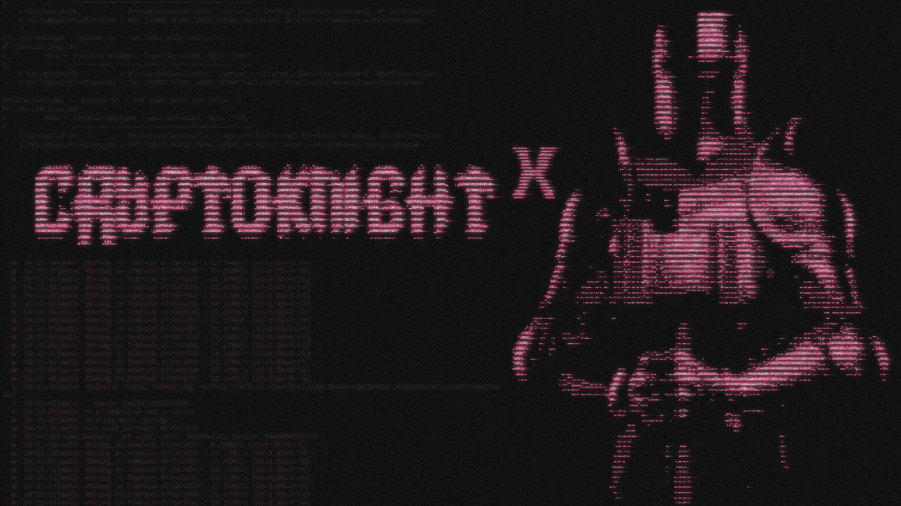

<!---banner by _surowo (discord)--->

<!---CKX--->

 
<h1 align="center">CryptoKnightX</h1>

CryptoKnightX é uma ferramenta CLI para criptografar arquivos utilizando GnuPG.

Mantenha a segurança e privacidade de seus arquivos importantes com simplicidade em seu terminal.

<!---DEPENDENCIAS--->

 
<h2 align="center">Dependências</h2>

Dependências necessárias para utilizar o software:

<ul>
   <li><b>UNIX Tar</b></li>
   <li><b><a href="https://www.gnu.org/software/bash/" target="_blank">Bash</a> 4+</b></li>
   <li><b><a href="https://gnupg.org/" target="_blank">gnupg</a> 2.2.7+</b></li>
</ul>

<!---INSTALAÇÃO--->

 
<h2 align="center">Como instalar?</h2>

Use um dos comandos logo abaixo para instalar o CKX:

<code>git</code>:

<pre>git clone https://github.com/ghostkill73/CryptoKnightX && cd CryptoKnightX && chmod +x ckx</pre>
 

<code>wget</code>:

<pre><code>wget https://raw.githubusercontent.com/ghostkill73/CryptoKnightX/main/ckx && chmod +x ckx</code></pre>
 

<code>curl</code>:

<pre><code>curl -L https://raw.githubusercontent.com/ghostkill73/CryptoKnightX/main/ckx > ckx && chmod +x ckx</code></pre>
 
